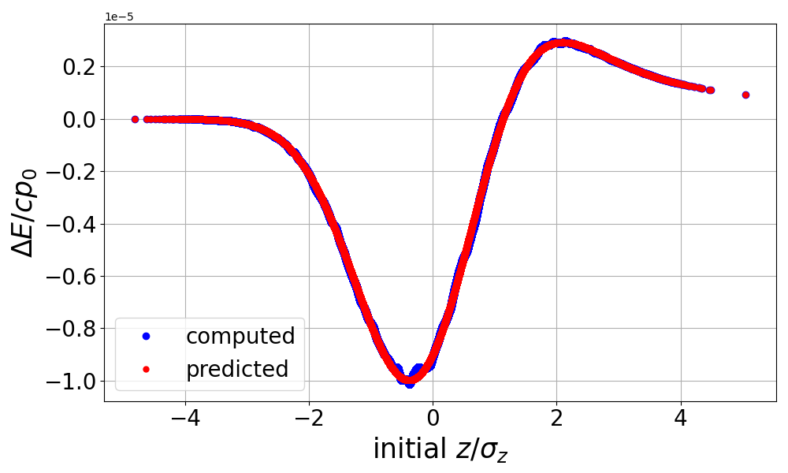

.. _examples-csr-kick:

Momentum Kick in the 1D Steady-State CSR Model
==============================================

The test compares the energy change due to CSR experienced by particles in a bending dipole within a long, initially cold, Gaussian bunch against the analytical model in:

C. Mitchell, J. Qiang, and P. Emma, Phys. Rev. Accel. Beams 16, 060703 (2013), eqs. (C5-C7).

We use a cold (zero emittance) 1 nC, 5 GeV electron bunch in one of the dipoles from the Zeuthen chicane benchmark.

A single slice is used, resulting in a single wakefield kick.  The bunch is initialized with zero momentum spread and zero transverse size, to avoid dynamical evolution during the half-step in the dipole field before the wakefield kick is applied.

In this test, the final momentum of every particle is compared against its predicted value.  Both the maximum error and its rms value over the bunch population are returned.  Both values must be zero within a small tolerance.

Run
---

This example can be run **either** as:

* **Python** script: ``python3 run_csr_kick.py`` or
* ImpactX **executable** using an input file: ``impactx input_csr_kick.in``

For `MPI-parallel <https://www.mpi-forum.org>`__ runs, prefix these lines with ``mpiexec -n 4 ...`` or ``srun -n 4 ...``, depending on the system.

.. tab-set::

   .. tab-item:: Python: Script

       .. literalinclude:: run_csr_kick.py
          :language: python3
          :caption: You can copy this file from ``examples/wake_csr_kick/run_csr_kick.py``.

   .. tab-item:: Executable: Input File

       .. literalinclude:: input_csr_kick.in
          :language: ini
          :caption: You can copy this file from ``examples/wake_csr_kick/input_csr_kick.in``.

Analyze
-------

We run the following script to analyze correctness:

.. dropdown:: Script ``analysis_csr_kick.py``

   .. literalinclude:: analysis_csr_kick.py
      :language: python3
      :caption: You can copy this file from ``examples/wake_csr_kick/analysis_csr_kick.py``.

Visualize
---------

You can run the following script to visualize the energy kick as a function of head-tail position along the bunch:

.. dropdown:: Script ``plot_csr_kick.py``

   .. literalinclude:: plot_csr_kick.py
      :language: python3
      :caption: You can copy this file from ``examples/wake_csr_kick/plot_csr_kick.py``.

   CSR wakefield generated by a Gaussian bunch in a bending dipole (1D steady-state model).
